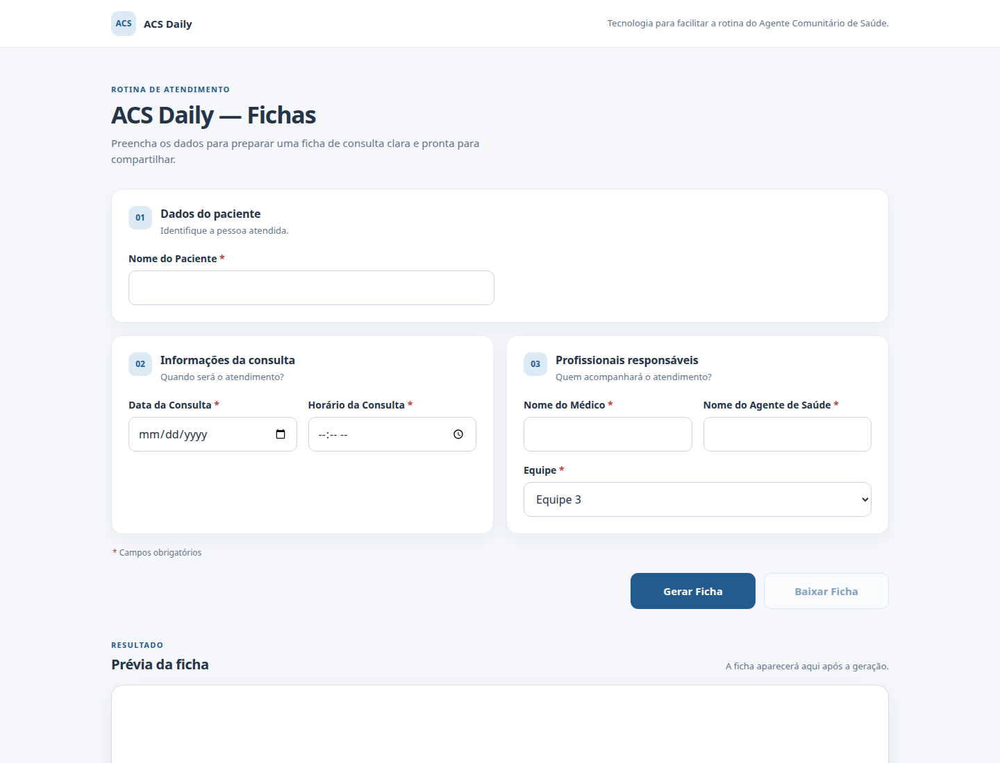
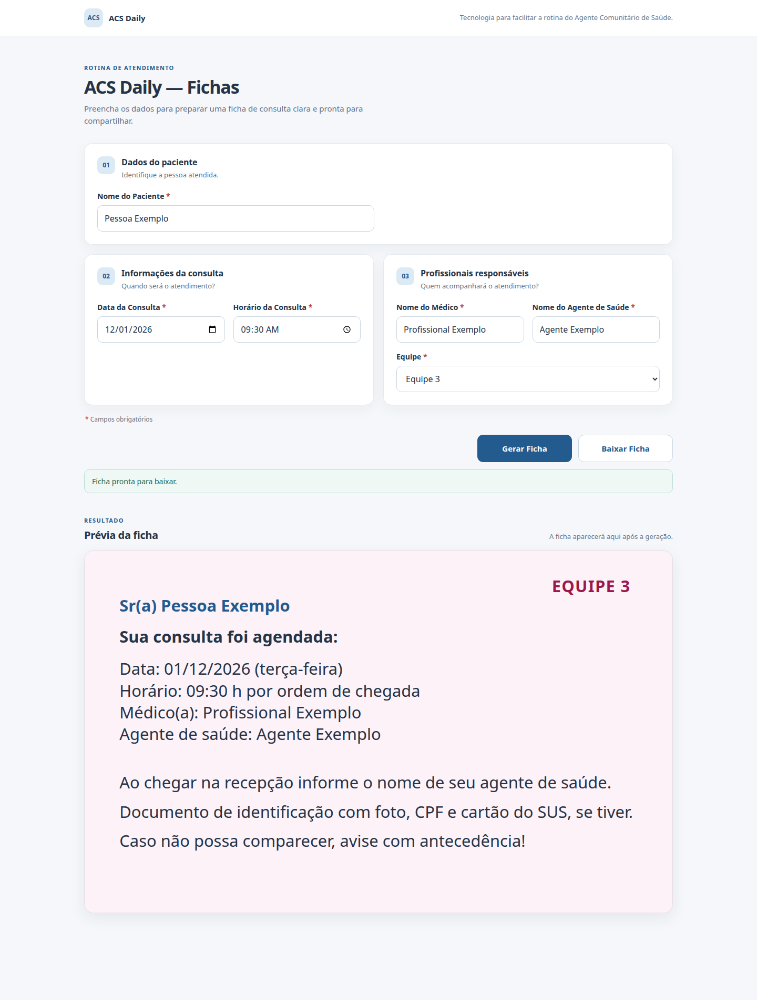

# ACS Daily — Fichas

## Apresentação

Gerador de fichas de consulta para apoiar a organização dos atendimentos realizados pelo Agente Comunitário de Saúde (ACS).

O ACS Daily — Fichas é a evolução do **Gerador de Fichas**, uma solução criada a partir de uma necessidade real da rotina da minha mãe, que trabalha como ACS. Nesta versão, a ficha é montada e preparada para download diretamente no navegador.

## Motivação

As fichas de agendamento eram preparadas inicialmente em papel. Mais tarde, o processo passou a ser feito digitalmente, principalmente pelo WhatsApp, mas cada consulta ainda exigia redigitar as mesmas informações. A falta de padronização também motivou a busca por uma maneira mais prática de preparar e compartilhar as orientações.

O primeiro Gerador de Fichas nasceu para reduzir esse trabalho repetitivo: bastava informar os dados do atendimento para criar uma ficha pronta para enviar ao paciente.

## História e evolução

### Primeira versão — Gerador de Fichas

A primeira implementação automatizou a criação das fichas em uma aplicação com frontend e backend. O servidor foi desenvolvido em Java com Spring Boot e gerava a imagem da ficha.

### Evolução — ACS Daily

O projeto evoluiu para uma nova implementação web, que gera a ficha no próprio navegador, sem depender do backend da versão original. A interface foi redesenhada para tornar o preenchimento mais claro, com atenção ao uso em dispositivos móveis, e passou a adotar a identidade ACS Daily.

O ecossistema também está se expandindo com o aplicativo mobile **ACS Daily — Agenda**, que está em desenvolvimento. Esta documentação não atribui funcionalidades a esse aplicativo que ainda não estejam implementadas e confirmadas.

## Funcionalidades implementadas

- Formulário com campos obrigatórios para nome do paciente, data e horário da consulta, médico, agente de saúde e equipe.
- Seleção da equipe disponível atualmente: **Equipe 3**.
- Prévia da ficha gerada na própria página, com data no formato brasileiro e dia da semana.
- Ficha com orientações sobre a chegada à recepção, documentos e aviso antecipado em caso de ausência.
- Geração de imagem PNG e download pelo botão **Baixar Ficha**.
- Layout responsivo e mensagens de estado durante a geração da ficha.

## Demonstração visual

As capturas abaixo mostram a interface e uma ficha de demonstração preenchida com dados fictícios.





## Tecnologias utilizadas na versão atual

- **HTML** — estrutura da página e do formulário.
- **CSS** — identidade visual, layout e adaptação a diferentes larguras de tela.
- **JavaScript** — validação do formulário, montagem da ficha e interação com a página.
- **html2canvas** — captura o conteúdo da ficha para gerar o PNG; é carregado pelo jsDelivr.

A geração da versão atual acontece no navegador. Java e Spring Boot pertencem à implementação original, não à versão web atual. O repositório não contém `package.json` nem uma etapa de build.

## Estrutura do projeto

```text
.
├── index.html
├── script.js
├── style.css
├── assets/
│   ├── images/
│   │   └── fita-outubro-rosa.png
│   └── screenshots/
│       ├── ficha-gerada.png
│       └── interface.png
└── README.md
```

## Como executar localmente

Na raiz do projeto, inicie um servidor estático:

```bash
python3 -m http.server 8000
```

Depois, abra <http://localhost:8000> no navegador. Também é possível abrir `index.html` diretamente. Para gerar e baixar o PNG, o navegador precisa conseguir carregar o html2canvas pelo jsDelivr, portanto é necessário acesso à internet.

## Geração e download das fichas

1. Preencha os campos obrigatórios do formulário.
2. Selecione **Gerar Ficha**. A aplicação monta a ficha na página e prepara uma imagem PNG no navegador.
3. Quando a ficha estiver pronta, selecione **Baixar Ficha** para baixá-la como `ficha.png`.

O arquivo pode então ser compartilhado com o paciente pelo meio escolhido pelo profissional. O projeto não envia a ficha diretamente pelo WhatsApp.

## Próximos passos

O aplicativo mobile **ACS Daily — Agenda** está em desenvolvimento como parte da expansão do ecossistema. Não há, neste README, previsão de data de lançamento ou descrição de funcionalidades ainda não confirmadas.
